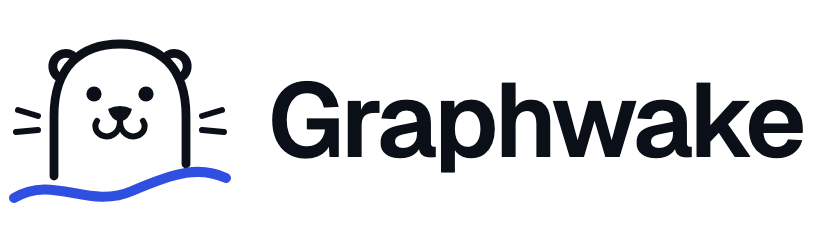

<picture>
  <source media="(prefers-color-scheme: dark)" srcset="https://raw.githubusercontent.com/graphwake/graphwake/main/assets/logo-dark.png">
  
</picture>

**Graphwake is the dependency map for your APIs.** It maps which teams depend on each endpoint of your OpenAPI specs,
shows the impact of a change before it merges, and tells only the teams it affects.

[graphwake.com](https://graphwake.com) &nbsp;&nbsp; [Pricing](https://graphwake.com/pricing) &nbsp;&nbsp; [hello@graphwake.com](mailto:hello@graphwake.com)

<picture>
  <source media="(prefers-color-scheme: dark)" srcset="https://raw.githubusercontent.com/graphwake/graphwake/main/assets/hero-dark.svg">
  
</picture>

## Not just what changed, but who it breaks

When one team changes its API, the teams that call it often find out when their app breaks. The change was never the
problem; the news never reached the right people.

Most API tooling answers *what changed?* Graphwake also answers **who is affected?** Consumer teams subscribe to the
endpoints they call, so a breaking change reaches every team it will hurt, before it merges, and stays out of everyone
else's channel.

## What's in Graphwake

| | |
|---|---|
| **Endpoint subscriptions** | Each consumer team marks the endpoints it depends on. The provider team doesn't have to keep a list. |
| **Breaking-change alerts** | Sent to Slack, Microsoft Teams or email, whichever channel each team picks. Only to the teams subscribed to the endpoint that changed. |
| **Service Graph** | A team-level map of who consumes and who owns every endpoint, across all your services. |
| **API Changes and Impact Analysis** | Every pull request's changes as one change set, with an impact score that shows its working, and which teams are left out and why. |
| **Discovery** | Suggests teams that may be affected by an endpoint nobody has mapped yet, and shows the signals behind each suggestion. |
| **Change History** | Every version of a contract, who changed it, and who was notified. The next incident review starts with facts. |
| **Teams and Ownership** | Teams, people and endpoint owners in one place, with a Monday report of the endpoints that have no consumer or no owner. |
| **Overview** | What needs attention across the workspace, at a glance. |
| **⌘K search** | Jump to any endpoint, service or team from anywhere in the app. |
| **CI agent** | One step in your pipeline sends the spec on every pull request and merge. It never fails your build. [graphwake/agent](https://github.com/graphwake/agent) |

<br>

<details>
<summary><b>What counts as breaking</b></summary>
<br>

A change that can make an existing client fail:

- an endpoint or a response field is removed
- a required parameter or request field is added
- a field's type changes
- the accepted values are narrowed

Additions, such as a new optional field, stay quiet by default. A workspace can turn non-breaking alerts on if it wants them.

</details>

<details>
<summary><b>How alerts work</b></summary>
<br>

Each team picks where its alerts land: a Slack channel, a Microsoft Teams channel or email. An alert names the
endpoint, what changed, who changed it and which pull request did it.

- **While the pull request is open**, subscribed teams hear about the breaking change before it merges.
- **When it merges or closes**, the same Slack or Teams message is updated, so the thread tells the whole story.
- **Nobody else is paged.** A team that calls the service but not the changed endpoint hears nothing.

Setting up a channel? Send a test alert first and see exactly what your team will get.

</details>

<details>
<summary><b>How your spec reaches Graphwake</b></summary>
<br>

Graphwake only needs your OpenAPI spec. It never asks for access to your source code.

**Give it the spec URL.** Graphwake checks a published OpenAPI spec every 30 minutes by default. Protected URLs work
with an auth header.

**Or add one step to your pipeline.** The [Graphwake CI agent](https://github.com/graphwake/agent) catches the change
before it merges:

| Build | What happens |
|---|---|
| Pull request | The spec is stored as a draft. Subscribed teams hear about breaking changes before they ship. |
| Default branch, after the merge | The spec becomes the live spec and the real notifications go out. |
| Anything else | Nothing is sent. |

```yaml
- uses: graphwake/agent/github-action@v0.1.0
  with:
    spec: openapi.json
    key: ${{ secrets.GRAPHWAKE_KEY }}
```

It runs on GitHub Actions, GitLab CI, Azure DevOps, Bitbucket Pipelines and Jenkins, or anywhere as a Docker image or a
binary for Linux, macOS and Windows. Every run shows up on the CI/CD page of the app.

</details>

<details>
<summary><b>Workspace and security</b></summary>
<br>

- Single sign-on with Microsoft Entra ID, verified company domains and invites.
- Your workspace on its own subdomain, if you want one.
- Each workspace's data is isolated with row-level security in the database.
- Data is stored in the EU (Frankfurt, eu-central-1).
- Graphwake reads your OpenAPI specs, not your code.

</details>

<br>

## Repositories

| | |
|---|---|
| [**agent**](https://github.com/graphwake/agent) | The Graphwake CI agent, written in Go. Sends your OpenAPI spec to Graphwake from pull request and default-branch builds. |

## Try it

Every workspace starts with a 7-day trial of every feature, no credit card needed.
[Start at graphwake.com](https://graphwake.com).
